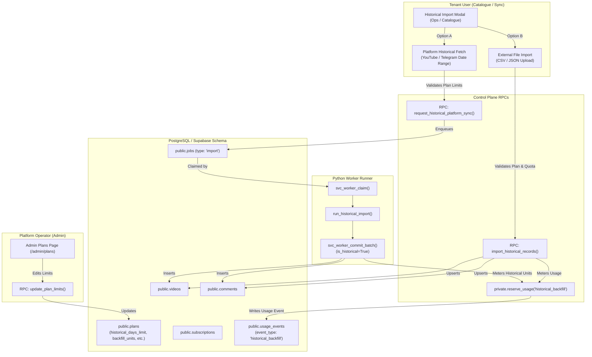

# Historical Data Import & Dynamic Plan Limits Design Specification

**Date:** 2026-09-23  
**Status:** Validated Design / Ready for Implementation  
**Domain:** Omnichannel Historical Backfill, External File Ingestion (CSV/JSON), Dynamic Plan Controls  

---

## 1. Problem Statement & Objectives

### Problem
Tenants currently can only track live or recent content discovered by automatic polling. When a creator, agency, or enterprise onboarding onto the platform wants to analyze audience sentiment over past campaigns, quarterly launches, or historical post archives, there is no direct mechanism to fetch historical posts/comments or upload external archives. Furthermore, while the database schema defined `backfill_units` on subscription tiers, historical backfill jobs were neither cleanly metered under `historical_backfill` nor gated by dynamic time-depth constraints (e.g., last 30 days for Creator, 90 days for Creator+, 365 days for Agency, full archive for Enterprise/Owner). Finally, platform operators currently have no dynamic controls in the Admin Dashboard to adjust plan limits on the fly.

### Objectives
1. **Dynamic Plan Constraints**:
   - Store and expose `historical_days_limit` and `backfill_units` per subscription plan tier in `public.plans`.
   - Provide an Admin Dashboard UI and secure RPC (`update_plan_limits`) enabling operators to dynamically edit all tier limits without code changes.
2. **Platform Historical Fetch (YouTube & Telegram)**:
   - Provide a user-facing Historical Import flow in `Catalogue.tsx` / `Sync.tsx` allowing users to select a historical date range governed by their plan tier.
   - Enqueue historical backfill jobs that fetch past posts/videos and comments within the allowed window.
   - Accurately meter comment ingestion against `historical_backfill` units without touching or starving the monthly `comment_analysis` quota.
3. **External File Import (CSV / JSON)**:
   - Allow users to import historical posts/videos and comments via standard CSV or JSON files directly into their workspace channels.
   - Validate format, check date range against `historical_days_limit`, verify comment count against `backfill_units_remaining`, and ingest atomically.
4. **Bilingual Arabic-First UX**:
   - Seamless Arabic and English support across all dialogs, tables, error messages, and admin controls.
5. **Rock-Solid Reliability & Testing**:
   - Comprehensive unit and integration tests across contracts, database migrations, Python workers, and web UI components.

---

## 2. Architecture & Data Flow



---

## 3. Database Specification

### 3.1 Migration: `20260923180000_historical_data_import_and_dynamic_plans.sql`

1. **Alter `public.plans`**:
   ```sql
   alter table public.plans
     add column if not exists historical_days_limit integer default 0
     check (historical_days_limit is null or historical_days_limit >= 0);
   ```
2. **Default Values**:
   - `free`: `historical_days_limit = 0`, `backfill_units = 0` (Historical import locked)
   - `creator`: `historical_days_limit = 30`, `backfill_units = 40000` (Last 30 days)
   - `creator_plus`: `historical_days_limit = 90`, `backfill_units = 120000` (Last 90 days)
   - `agency`: `historical_days_limit = 365`, `backfill_units = 600000` (Last 1 year)
   - `media`: `historical_days_limit = 730`, `backfill_units = 2000000` (Last 2 years)
   - `enterprise`: `historical_days_limit = null`, `backfill_units = 4000000` (Unlimited date depth)
   - `owner`: `historical_days_limit = null`, `backfill_units = null` (Unlimited everything)

3. **Update `private.plan_json`**:
   Exposes `backfill_units` and `historical_days_limit` inside `limits`.

4. **Add `private.backfill_remaining(w uuid) returns integer`**:
   Calculates remaining historical backfill allowance.

5. **Update `private.commit_batch`**:
   If job type is `'import'` or payload indicates `is_historical`, reserves usage under `'historical_backfill'`.

6. **Create `public.update_plan_limits(p_plan_key text, p_limits jsonb) returns jsonb`**:
   Enforces `public.is_platform_admin()`, updates tier limits dynamically, and records an audit log.

7. **Create `public.request_historical_platform_sync(w uuid, c uuid, since_date timestamptz, max_items int default 500) returns jsonb`**:
   Validates tenant role, plan days limit, and backfill quota, then creates an `'import'` job.

8. **Create `public.import_historical_records(w uuid, c uuid, payload jsonb) returns jsonb`**:
   Accepts structured JSON containing posts and comments, verifies date depth and backfill quota, inserts records, meters usage against `historical_backfill`, and returns statistics.

---

## 4. Contracts & Schemas

### `packages/contracts/src/plans.ts`
- Extend `PlanLimitsSchema` with:
  - `backfill_units: z.number().int().min(-1)`
  - `historical_days_limit: z.number().int().min(-1)`

### `packages/contracts/src/historical.ts` [NEW]
- Define schemas for:
  - `HistoricalImportItemSchema`: Post/comment representation.
  - `HistoricalImportPayloadSchema`: `{ posts: [...], comments: [...] }`.
  - `HistoricalImportResultSchema`: Statistics returned by import.
  - `HistoricalSyncRequestSchema`: Request payload for platform sync.
  - `PlanLimitsUpdateSchema`: Payload for admin updating plan limits.

---

## 5. Frontend & UI Implementation

### 5.1 Admin Control Panel (`apps/web/src/admin/AdminPlansPage.tsx`)
- Add a new action column / button: "تعديل القيود" (Edit Limits).
- Add an `EditPlanLimitsDialog`:
  - Input for `backfill_units` (عدد وحدات الاستيراد التاريخي).
  - Input for `historical_days_limit` (الحد الأقصى للأيام التاريخية: 0, 30, 90, 365, أو غير محدود).
  - Input for `analysis_units` (وحدات التحليل الشهرية).
  - Input for `topic_units` (وحدات تصنيف الموضوعات).
  - Checkbox for `allow_public_channels`.
  - Save button calling `updatePlanLimits(planKey, limits)`.

### 5.2 Catalogue & Sync Ops (`HistoricalImportModal.tsx`)
- Opened from `Catalogue.tsx` ("استيراد البيانات التاريخية") or `Sync.tsx`.
- Gated by plan:
  - If `free`, shows upgrade callout explaining historical features unlock on paid tiers.
- Two tabs:
  1. **جلب من المنصة (Platform Fetch)**:
     - Shows current plan limit (e.g., "خطتك تتيح جلب حتى 90 يوماً سابقة").
     - Shows available `backfill_units`.
     - Presets: "آخر 30 يوم", "آخر 90 يوم", "تاريخ مخصص".
     - Submit button triggers `request_historical_platform_sync`.
  2. **رفع ملف خارجي (CSV / JSON)**:
     - Drag-and-drop file uploader accepting `.csv` or `.json`.
     - Sample CSV/JSON template download.
     - Client-side parser and preview validator (item counts, date ranges).
     - Submit button calls `import_historical_records`.

---

## 6. Verification & Test Plan

1. **Database Integration Tests (`tests/historical_import_rpc.test.ts`)**:
   - Verify `update_plan_limits` enforces admin check.
   - Verify `historical_days_limit` rejection when user requests date outside plan allowance.
   - Verify `backfill_remaining` decrements on `import_historical_records`.
   - Verify non-interference between `historical_backfill` and `comment_analysis` quotas.
2. **Worker Unit Tests (`workers/python/tests/test_historical_import.py`)**:
   - Verify historical import runner sets `is_historical=True` in batch commit.
   - Verify collector receives `since` timestamp filter.
3. **Admin Web Component Tests (`AdminPlansPage.test.tsx`)**:
   - Verify editing limits updates the UI and sends correct RPC payload.
4. **Historical Modal Tests (`HistoricalImportModal.test.tsx`)**:
   - Verify gating on free plans.
   - Verify parsing and preview of CSV/JSON files.
   - Verify submission of historical sync requests.
5. **Full Gates**:
   - `npm run check` (Lint + TypeCheck + Build + Vitest).
   - `uv run pytest` in `workers/python`.
